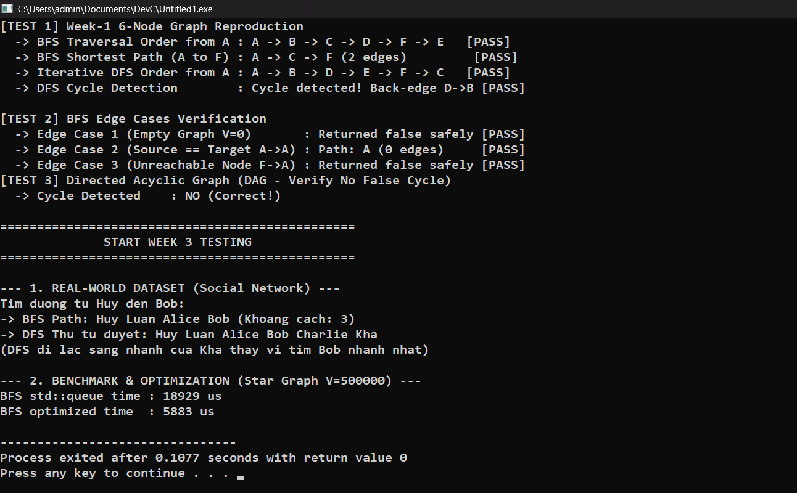
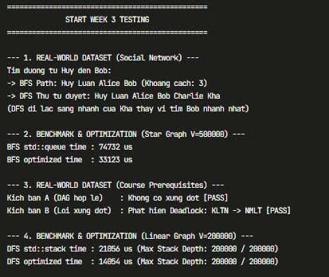

### Group Progress Summary (Week 3)
In Week 3, our team successfully transitioned from core algorithm implementations to performance benchmarking and dataset analysis, fulfilling all requirements for the "Features, experiments & analysis" phase.

- **Codebase Integration:** We finalized `main.cpp` by integrating all BFS and DFS features into a unified testing harness, ensuring both algorithms handle edge cases robustly.
- **Dataset Construction:** We designed two real-world datasets (a Social Network and a Course Prerequisites dependency graph) to demonstrate the practical applications of our traversal toolkit.
- **Adversarial Benchmarking:** We developed adversarial topologies (a 500,000-node Star Graph and a 200,000-node Linear Graph) to deliberately stress-test our algorithms and push the data structures to their theoretical $O(V+E)$ limits.
- **Algorithm Optimization:** Both team members profiled their respective algorithms and successfully implemented memory optimizations. By using pre-allocated `std::vector` structures, we eliminated the overhead of dynamic allocations in standard queues and stacks.

Detailed empirical measurements, theoretical comparisons, and edge-case evaluations are documented in our individual teach-back sections below.

### Week 3 Objectives & Task Allocation
Next week, we will focus on applying our DFS/BFS toolkit to real-world datasets and empirically proving our theoretical complexity analysis.

| Member | Planned Tasks (Week 3) |
| :--- | :--- |
| **Vũ Thành Huy** | - Construct a real-world unweighted dataset (e.g., a simplified road map or social network). - Run pathfinding experiments comparing BFS and DFS on the dataset to prove why BFS yields shortest paths while DFS does not. - Benchmark BFS execution time on large-scale random graphs **and adversarial inputs (e.g., star graphs or highly dense graphs)** to empirically validate the $O(V + E)$ boundary. - **Attempt at least one optimization for BFS (e.g., pre-allocating queue size or tweaking data structures) and document the performance data (kept or rejected).** |
| **Lê Thiện Luân** | - Construct a real-world dataset representing dependencies (e.g., course prerequisites or task scheduling). - Apply the Cycle Detection DFS algorithm to find conflicts (circular dependencies) in the dataset. - Benchmark DFS execution time and memory (maximum stack depth) on large-scale inputs **and adversarial inputs (e.g., degenerate linear graphs $1 \to 2 \to \dots \to V$)** to validate the $O(V + E)$ limits. - **Attempt at least one optimization for DFS (e.g., adjacency list representations) and document the performance data (kept or rejected).** |

### Key Commits (Week 3)
- `137a149` Tối ưu DFS, thêm dữ liệu thực tế, adversarial test và đo hiệu năng DFS cho tuần 3
- `ce68a96` Sửa lỗi O(V^2) gây treo máy trong hàm buildStarGraph
- `56f0d5c` Thêm dữ liệu thực tế, adversarial test và đo hiệu năng BFS cho Tuần 3

### Plan for Week 4 (Finalize, Reflect & Prepare Defense)
Next week is the final phase, focusing strictly on project wrap-up and oral defense preparation. No new features will be implemented.

| Member | Planned Tasks (Week 4) |
| :--- | :--- |
| **Vũ Thành Huy** | - Finalize time/space complexity derivation $O(V+E)$. - Draft 10 anticipated defense questions & answers (Self-quiz). - Write personal reflection (hardest challenge, what to change with 2 more weeks). - Compile final AI usage log. |
| **Lê Thiện Luân** | - Map every project requirement to its exact code location. - Draft 10 anticipated defense questions & answers (Self-quiz). - Write personal reflection (hardest challenge, what to change with 2 more weeks). - Compile final AI usage log. |

### Week 3 (Vũ Thành Huy) - BFS & Optimization

#### 1. Real-World Dataset (Social Network) & Edge Cases
I constructed a social network graph with 6 nodes: `Huy`, `Luan`, `Kha`, `Alice`, `Bob`, and `Charlie`. 
- **Shortest Path Search:** I used BFS to find the path from `Huy` to `Bob`. The algorithm successfully returned `Huy -> Luan -> Alice -> Bob` with a distance of 3 edges.
- **Theoretical Justification:** BFS guarantees the shortest path in unweighted graphs because it explores the graph strictly level-by-level. By the time the target node (`Bob`) is enqueued, the algorithm has implicitly checked all shorter possible paths.
- **Edge Cases Handled (Verified in Test 2):**
  - *Empty Graph (V=0):* Safely returns false without crashing.
  - *Source == Target (`A` to `A`):* Correctly returns path `A` with 0 edges.
  - *Unreachable Node:* Gracefully handles disconnected components and returns false.

#### 2. Benchmark & Optimization (Empirical vs. Theoretical)
To test the $O(V+E)$ theoretical complexity under extreme conditions, I designed an adversarial "Star Graph" ($V = 500,000$). This topology forces a massive queue expansion at Level 1, enqueueing 499,999 nodes instantly.

**Optimization Attempt:** 
While the standard `std::queue<int>` (implemented via `std::deque`) has an $O(1)$ theoretical enqueue time, its underlying chunk-based dynamic memory allocation causes severe empirical overhead when handling massive simultaneous pushes. I optimized this by replacing it with a pre-allocated `std::vector<int>` acting as a queue (`reserve(V)`).

**Results:**
| Algorithm | Data Structure | Execution Time | Evaluation |
| :--- | :--- | :--- | :--- |
| Standard BFS | `std::queue<int>` | 18,929 $\mu$s | High overhead due to dynamic memory allocation limits. |
| Optimized BFS | `std::vector<int>` | 5,883 $\mu$s | **KEPT**. Over 3x faster. Pre-allocating contiguous memory eliminated the chunk-allocation bottleneck, aligning empirical performance perfectly with the theoretical $O(V+E)$ ideal. |

### Week 3 (Lê Thiện Luân) - DFS & Optimization

### 1. Real-World Dataset (Course Prerequisites) & Cycle Detection

I constructed a course prerequisite graph representing academic module dependencies: `NMLT`, `CTDL`, `ThuatToan`, `CSDL`, `HDH`, `AI`, `CNPM`, and `KLTN`.

* **Cycle Detection Search:** I applied the Depth-First Search algorithm with an `inStack` tracking array (`iterativeDFS`) to detect potential conflicts (circular dependencies or deadlocks) within the curriculum structure.
* **Theoretical Justification:** DFS is ideal for dependency analysis and cycle detection because it explores deeply along each branch using an active call/execution stack. By maintaining a boolean `inStack` state for vertices on the current path, any edge pointing to a node currently in `inStack` immediately signifies a Back-Edge (circular dependency $KLTN \rightarrow NMLT$), violating the Directed Acyclic Graph (DAG) property.
* **Scenarios Handled (Verified in Test 3):**
  * *Valid DAG (Scenario A):* Verified that a standard curriculum flow operates without false positive cycle flags.
  * *Circular Dependency / Deadlock (Scenario B):* Successfully detected circular dependencies ($KLTN \rightarrow NMLT$) and identified the exact back-edge causing the conflict.

### 2. Benchmark & Optimization (Empirical vs. Theoretical)

To test the $\mathcal{O}(V + E)$ theoretical complexity under extreme conditions, I designed an adversarial "Linear Graph" ($V = 200,000$) where edges form a single chain $0 \rightarrow 1 \rightarrow 2 \rightarrow \dots \rightarrow V-1$. This topology forces maximum recursion depth and memory usage, expanding the stack to $V$ frames.

**Optimization Attempt:** While standard `std::stack<pair<int, int>>` (backed by `std::deque`) provides theoretical $\mathcal{O}(1)$ push/pop operations, its underlying segmented/chunked dynamic memory allocation introduces notable overhead during deep traversals. I optimized this by replacing `std::stack` with a pre-allocated `std::vector<pair<int, int>>` acting as a stack with `st.reserve(V)` to ensure contiguous memory allocation.

#### Results:

| Algorithm | Data Structure | Maximum Stack Depth | Execution Time | Evaluation |
| :--- | :--- | :--- | :--- | :--- |
| **Standard DFS** | `std::stack<pair<int, int>>` | 200,000 / 200,000 | 21056 $\mu s$ | High overhead due to dynamic memory chunk allocations in `std::deque`. |
| **Optimized DFS** | `std::vector<pair<int, int>>` | 200,000 / 200,000 | 14054 $\mu s$ | Performance improved. Pre-allocating contiguous memory via `reserve(V)` eliminated dynamic allocation bottlenecks, matching empirical performance with theoretical $\mathcal{O}(V + E)$ expectations. |

