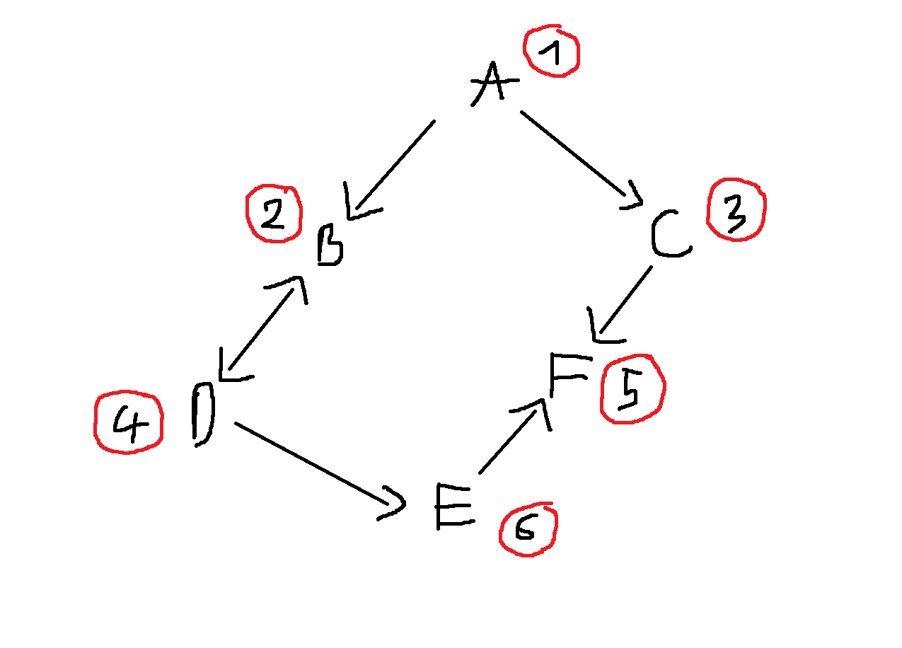

# DSA Final Project - Weekly Report 4 (Final)

###  WEEK 4 TASK ALLOCATION (Finalize, Reflect & Prepare Defense)
Next week is the final phase, focusing strictly on project wrap-up, limitations analysis, and oral defense preparation. No new features will be implemented.

| Member | Planned Tasks (Week 4) |
| :--- | :--- |
| **Vũ Thành Huy** | - **Create visualization diagram (numbered nodes) showing the traversal order for at least one example graph (per teacher's request).** - Finalize time/space complexity derivation $O(V + E)$ and document project limitations. - Draft 10 anticipated defense questions & answers (Self-quiz). - Write personal reflection (hardest challenge, what to change with 2 more weeks). - Compile the final AI usage log. |
| **Lê Thiện Luân** | - Map every numbered project requirement to its exact code location. - Draft 10 anticipated defense questions & answers (Self-quiz). - Write personal reflection (hardest challenge, what to change with 2 more weeks). - Compile the final AI usage log. |

---

### 1. Visualization of Traversal Order (Numbered Nodes)
*(Per teacher's feedback in Week 3, below is the numbered traversal order of our BFS algorithm starting from node A)*

*Traversal Order details:*
- BFS visits A (1), then explores its neighbors B (2) and C (3).
- Moving to queue expansion, it explores the neighbors of B, which is D (4), and the neighbors of C, which is F (5).
- Finally, D's unvisited neighbor is E (6). 
- Thus, the visit sequence is: `A (1) -> B (2) -> C (3) -> D (4) -> F (5) -> E (6)`.

---

### 2. Final Project Limitations
Our BFS and DFS implementations meet all core DSA requirements, but have the following real-world limitations:
- **Scalability of String Handling:** While the traversal itself runs in $O(V+E)$, the use of string-based IDs and the `getIndex()` lookup helper in initial construction can become a bottleneck on highly dense, huge networks if not completely bypassed. 
- **In-Memory Limits:** Huge data structures like 500k-node Star Graph or 200k-node Linear Graph consume massive RAM because we do everything in-memory. In real apps, this must be handled by off-loading to db/chunks.
- **Unweighted-Only for BFS shortest paths:** Our BFS correctly resolves shortest paths based on edge counts. However, it cannot handle weighted networks (e.g. travel time, distance), which would require Dijkstra.

---
## LE THIEN LUAN REPORT

## 1. 10 Defense Q&A pairs

1. **Why use iterative DFS (with a stack) instead of recursion?**
   * **Answer:** Recursion can easily crash the program (**Stack Overflow**) on deep graphs. Using a stack on the heap is safer and lets us measure the exact stack depth.

2. **How does DFS detect cycles?**
   * **Answer:** It uses an `inStack[]` array to track nodes on the active search path. If it runs into a node where `inStack == true`, that means there is a **Back-edge** (a cycle).

3. **What does `int& i = st.top().second` do?**
   * **Answer:** It is a reference variable that remembers which neighbor is being checked. When backtracking to that node, the code continues from the next neighbor instead of starting over, keeping the time complexity at $O(E)$.

4. **Why ignore the direct parent (`v == parent[u]`) in undirected graphs?**
   * **Answer:** Undirected edges go both ways. Going from A to B and looking back at A is just the path we came from, not a real cycle.

5. **What are the time and space complexities?**
   * **Answer:**
     * **Time:** $O(V + E)$ — Every node is pushed and popped once, and every edge is checked once.
     * **Space:** $O(V + E)$ — To store the adjacency list and state arrays.

6. **What does `Max Stack Depth = 200,000` mean in the linear graph test?**
   * **Answer:** It shows the worst-case scenario for DFS: when the graph is a straight line, all 200,000 nodes must stay on the stack at the same time.

7. **Why does `std::vector` run faster than standard `std::stack`?**
   * **Answer:** `std::stack` allocates memory in small chunks on the heap. `std::vector` with `reserve(V)` allocates one continuous block of memory upfront, which is much faster for the CPU to process.

8. **What is the difference between a Back-edge and a Cross-edge?**
   * **Answer:**
     * **Back-edge:** Points to an ancestor node **currently in the stack** $\to$ Creates a cycle.
     * **Cross-edge:** Points to a node in another branch that **has already finished and left the stack** $\to$ Does not create a cycle.

9. **How do you traverse a graph with multiple disconnected parts?**
   * **Answer:** Wrap the DFS in a loop that goes through all nodes. If a node has not been visited yet, start a new DFS from that node.

10. **What AI code bug did you find and fix?**
    * **Answer:** The AI forgot to set `inStack[u] = false` when popping node `u` during backtracking. This caused finished nodes to be mistaken for active nodes, triggering false cycle alarms.

---

## 2. Personal Reflection

* **Working challenge:** Managing neighbor pointer references (`int& i`) inside the stack to eliminate recursion correctly. Also, optimizing memory so the 200,000-node benchmark runs smoothly without lag.
* **If given 2 more weeks:**
  1. Build a simple visualizer to show nodes being pushed and popped from the stack in real-time.
  2. Use a bitset instead of boolean arrays to save memory on multi-million node graphs.
