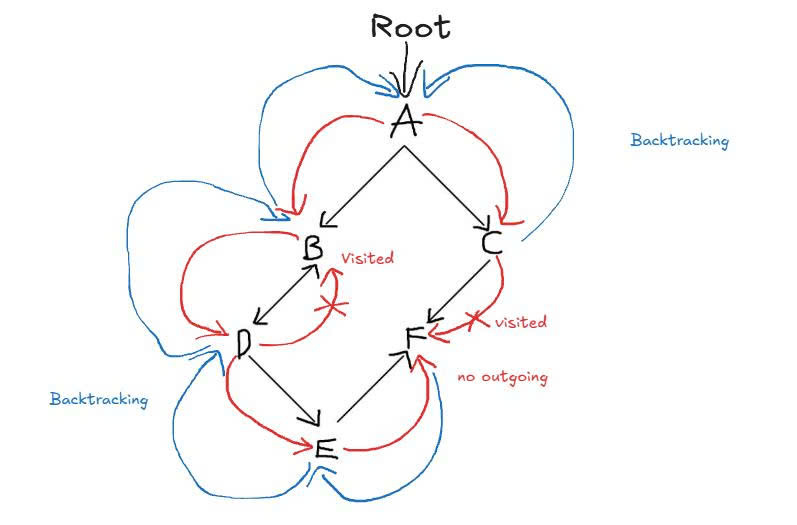

# DSA Final Project - Weekly Report 4 (Final)

###  WEEK 4 TASK ALLOCATION (Finalize, Reflect & Prepare Defense)
Next week is the final phase, focusing strictly on project wrap-up, limitations analysis, and oral defense preparation. No new features will be implemented.

| Member | Planned Tasks (Week 4) |
| :--- | :--- |
| **Vũ Thành Huy** | - **Create visualization diagram (numbered nodes) showing the traversal order for at least one example graph (per teacher's request).** - Finalize time/space complexity derivation $O(V + E)$ and document project limitations. - Draft 10 anticipated defense questions & answers (Self-quiz). - Write personal reflection (hardest challenge, what to change with 2 more weeks). - Compile the final AI usage log. |
| **Lê Thiện Luân** | - Map every numbered project requirement to its exact code location. - Draft 10 anticipated defense questions & answers (Self-quiz). - Write personal reflection (hardest challenge, what to change with 2 more weeks). - Compile the final AI usage log. |

---

### 1. Visualization of Traversal Order (Numbered Nodes)
*(Per teacher's feedback in Week 3, below is the numbered traversal order of our BFS algorithm starting from node A)*

*Traversal Order details:*
- BFS visits A (1), then explores its neighbors B (2) and C (3).
- Moving to queue expansion, it explores the neighbors of B, which is D (4), and the neighbors of C, which is F (5).
- Finally, D's unvisited neighbor is E (6). 
- Thus, the visit sequence is: `A (1) -> B (2) -> C (3) -> D (4) -> F (5) -> E (6)`.

---

### 2. Final Project Limitations
Our BFS and DFS implementations meet all core DSA requirements, but have the following real-world limitations:
- **Scalability of String Handling:** While the traversal itself runs in $O(V+E)$, the use of string-based IDs and the `getIndex()` lookup helper in initial construction can become a bottleneck on highly dense, huge networks if not completely bypassed. 
- **In-Memory Limits:** Huge data structures like 500k-node Star Graph or 200k-node Linear Graph consume massive RAM because we do everything in-memory. In real apps, this must be handled by off-loading to db/chunks.
- **Unweighted-Only for BFS shortest paths:** Our BFS correctly resolves shortest paths based on edge counts. However, it cannot handle weighted networks (e.g. travel time, distance), which would require Dijkstra.

---

## VU THANH HUY REPORT

### 1. 10 Defense Q&A pairs (BFS & Optimizations)
1. **Why does BFS guarantee the shortest path in unweighted graphs?**
   * **Answer:** BFS explores nodes level-by-level based on their edge distance from the source. The first time the algorithm reaches the target node, it is guaranteed to be via the shortest possible path (minimum number of edges).
2. **How do you reconstruct the exact path from source to target?**
   * **Answer:** I use a `parent[]` array. When discovering a new node `v` from node `u`, I record `parent[v] = u`. After reaching the target, I backtrack from `target` to `start` using this array, then reverse the sequence.
3. **What is the time complexity of your BFS implementation?**
   * **Answer:** It runs in $\mathcal{O}(V + E)$ time. Every vertex is enqueued/dequeued at most once ($\mathcal{O}(V)$), and every adjacent edge is checked exactly once across the whole traversal ($\mathcal{O}(E)$).
4. **Why did the 500,000-node Star Graph cause the program to freeze initially?**
   * **Answer:** It was an $\mathcal{O}(V^2)$ bug during graph construction. The AI suggested building the graph by repeatedly calling `addEdge(u, v)`. However, `addEdge` uses `getIndex()`, which does a linear string search. Running this 500,000 times froze the machine. I fixed it by bypassing string lookups and pushing directly to the adjacency list.
5. **Explain your memory optimization using `std::vector` instead of `std::queue`.**
   * **Answer:** Standard `std::queue` allocates memory dynamically in chunks, which slows down execution on massive graphs (18,929 $\mu$s). By switching to a `std::vector` and using `reserve(V)`, I pre-allocated a single continuous block of memory. This dropped the time to 5,883 $\mu$s.
6. **How does your BFS handle an unreachable target node?**
   * **Answer:** After the queue empties, the code checks `if (!visited[target]) return false;`. This prevents the path reconstruction loop from triggering an out-of-bounds error or infinite loop.
7. **Why did you use an Adjacency List instead of an Adjacency Matrix?**
   * **Answer:** Real-world networks (like social graphs or road maps) are sparse. An Adjacency Matrix would waste $\mathcal{O}(V^2)$ space (mostly zeros). The Adjacency List only uses $\mathcal{O}(V + E)$ space and allows iterating over actual neighbors directly.
8. **What happens if the start or target node doesn't exist in the graph?**
   * **Answer:** The `getIndex()` function will return `-1`. I added a guard clause `if (start == -1 || target == -1) return false;` at the very beginning to safely terminate the function.
9. **What is the loop invariant for the BFS queue?**
   * **Answer:** At any point, the queue contains nodes from at most two consecutive distance layers (e.g., distance $d$ and distance $d+1$), and they are strictly ordered.
10. **What AI bug did you find during edge-case testing?**
    * **Answer:** The AI's backtracking code unconditionally pushed the `start` node at the end without checking if the target was actually visited. If the target was unreachable, it falsely returned a 1-edge path. I added the unreachable check to fix this.

### 2. Personal Reflection
* **Working challenge:** The hardest part was bridging the gap between theory and hardware reality. Theoretical $\mathcal{O}(V+E)$ complexity looks perfect on paper, but standard STL containers (`std::queue`) introduced hidden dynamic allocation bottlenecks that only surfaced during the 500,000-node stress test. Identifying the $\mathcal{O}(V^2)$ string search bug during data generation was a massive learning moment.
* **If given 2 more weeks:**
  1. I would implement an `unordered_map<string, int>` for vertex lookups to reduce `getIndex()` from $\mathcal{O}(V)$ to $\mathcal{O}(1)$.
  2. I would extend the pathfinding algorithm to support weighted edges by implementing Dijkstra's algorithm.

---
## LE THIEN LUAN REPORT

### 1. 10 Defense Q&A pairs

1. **Why use iterative DFS (with a stack) instead of recursion?**
   * **Answer:** Recursion can easily crash the program (**Stack Overflow**) on deep graphs. Using a stack on the heap is safer and lets us measure the exact stack depth.

2. **How does DFS detect cycles?**
   * **Answer:** It uses an `inStack[]` array to track nodes on the active search path. If it runs into a node where `inStack == true`, that means there is a **Back-edge** (a cycle).

3. **What does `int& i = st.top().second` do?**
   * **Answer:** It is a reference variable that remembers which neighbor is being checked. When backtracking to that node, the code continues from the next neighbor instead of starting over, keeping the time complexity at $O(E)$.

4. **Why ignore the direct parent (`v == parent[u]`) in undirected graphs?**
   * **Answer:** Undirected edges go both ways. Going from A to B and looking back at A is just the path we came from, not a real cycle.

5. **What are the time and space complexities?**
   * **Answer:**
     * **Time:** $O(V + E)$ — Every node is pushed and popped once, and every edge is checked once.
     * **Space:** $O(V + E)$ — To store the adjacency list and state arrays.

6. **What does `Max Stack Depth = 200,000` mean in the linear graph test?**
   * **Answer:** It shows the worst-case scenario for DFS: when the graph is a straight line, all 200,000 nodes must stay on the stack at the same time.

7. **Why does `std::vector` run faster than standard `std::stack`?**
   * **Answer:** `std::stack` allocates memory in small chunks on the heap. `std::vector` with `reserve(V)` allocates one continuous block of memory upfront, which is much faster for the CPU to process.

8. **What is the difference between a Back-edge and a Cross-edge?**
   * **Answer:**
     * **Back-edge:** Points to an ancestor node **currently in the stack** $\to$ Creates a cycle.
     * **Cross-edge:** Points to a node in another branch that **has already finished and left the stack** $\to$ Does not create a cycle.

9. **How do you traverse a graph with multiple disconnected parts?**
   * **Answer:** Wrap the DFS in a loop that goes through all nodes. If a node has not been visited yet, start a new DFS from that node.

10. **What AI code bug did you find and fix?**
    * **Answer:** The AI forgot to set `inStack[u] = false` when popping node `u` during backtracking. This caused finished nodes to be mistaken for active nodes, triggering false cycle alarms.

### 2. Personal Reflection

* **Working challenge:** Managing neighbor pointer references (`int& i`) inside the stack to eliminate recursion correctly. Also, optimizing memory so the 200,000-node benchmark runs smoothly without lag.
* **If given 2 more weeks:**
  1. Build a simple visualizer to show nodes being pushed and popped from the stack in real-time.
  2. Use a bitset instead of boolean arrays to save memory on multi-million node graphs.

### 3. Mapping project requirements to code

| No. | Project requirement | Code location (`main.cpp`) | Simple explanation |
| :---: | :--- | :--- | :--- |
| **1** | Graph storage | Lines 13–56 | Stores the graph using an adjacency list (`vector<vector<int>> adj`) for both directed and undirected graphs. |
| **2** | Non-recursive DFS | Lines 59–114 | Uses a loop and a custom `std::stack` instead of recursion to prevent system crashes. |
| **3** | Cycle detection (deadlock) | Lines 66, 75, 94, 98, 108 | Uses an `inStack[]` array to track active nodes on the path. If we hit a node where `inStack == true`, a **cycle** is found. |
| **4** | BFS & shortest path | Lines 115–162 | Implements BFS traversal using `std::queue` and reconstructs the shortest path via the `parent[]` array. |
| **5** | BFS optimization | Lines 163–194 | Replaces `std::queue` with `std::vector` and `reserve(V)` to remove dynamic memory allocation overhead. |
| **6** | DFS memory optimization | Lines 197–223 | Replaces `std::stack` with `std::vector` and `reserve(V)` to allocate contiguous memory, making the code run faster. |
| **7** | Real-world social network dataset | Lines 226–235, 394–410 | Builds a 6-node social network to test BFS shortest path search from Huy to Bob. |
| **8** | Large-scale benchmark dataset (BFS) | Lines 238–250, 413–422 | Generates a 500,000-node star graph to stress-test queue capacity and prove O(V+E) time limit. |
| **9** | Real-world course dataset | Lines 252–268, 431–440 | Simulates course prerequisites and creates a circular dependency scenario (deadlock: Course A needs B, Course B needs A). |
| **10** | Large-scale benchmark dataset (DFS) | Lines 271–280 | Creates a linear graph with 200,000 connected nodes to force the stack to hold all nodes at once. |
| **11** | Runtime & stack depth test | Lines 283–308, 442–461 | Measures max stack depth and compares execution time between standard and optimized code. |
| **12** | BFS edge case verification | Lines 358–384 | Tests boundary cases: empty graph (V = 0), source equals target (A → A), and unreachable target (F → A). |
| **13** | BFS performance benchmark | Lines 413–429 | Measures and compares execution time between standard `std::queue` BFS and optimized `std::vector` BFS on 500,000 nodes. |

### 4. Visualization of traversal order

*Traversal Order details:*

- **DFS visits A (1)**, then dives deep into its first neighbor **B (2)**.
- From **B**, it continues deeper to **D (3)**, then **E (4)**, and reaches **F (5)**.
- After backtracking back to **A**, it explores the remaining unvisited neighbor **C (6)**.
- **Thus, the visit sequence is:** `A (1) -> B (2) -> D (3) -> E (4) -> F (5) -> C (6)`.
